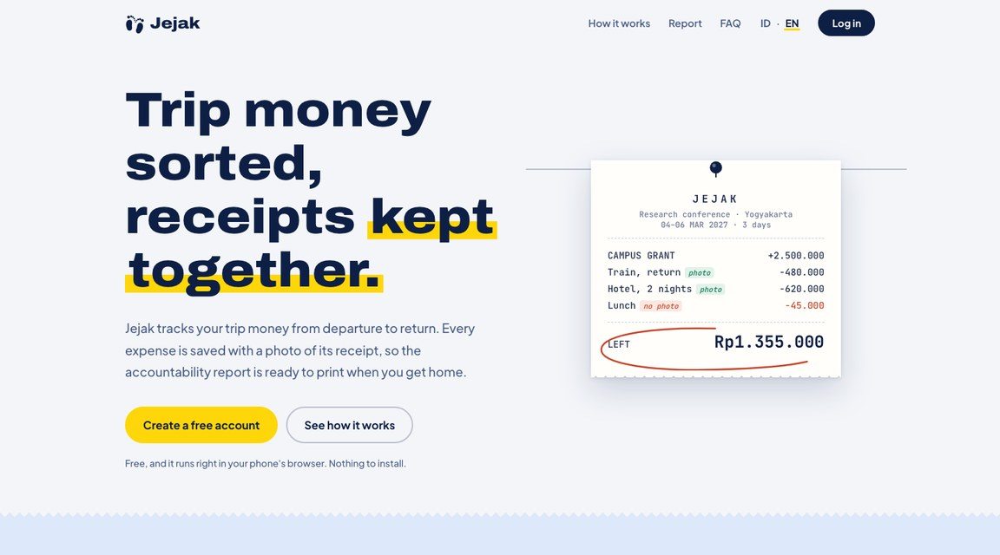
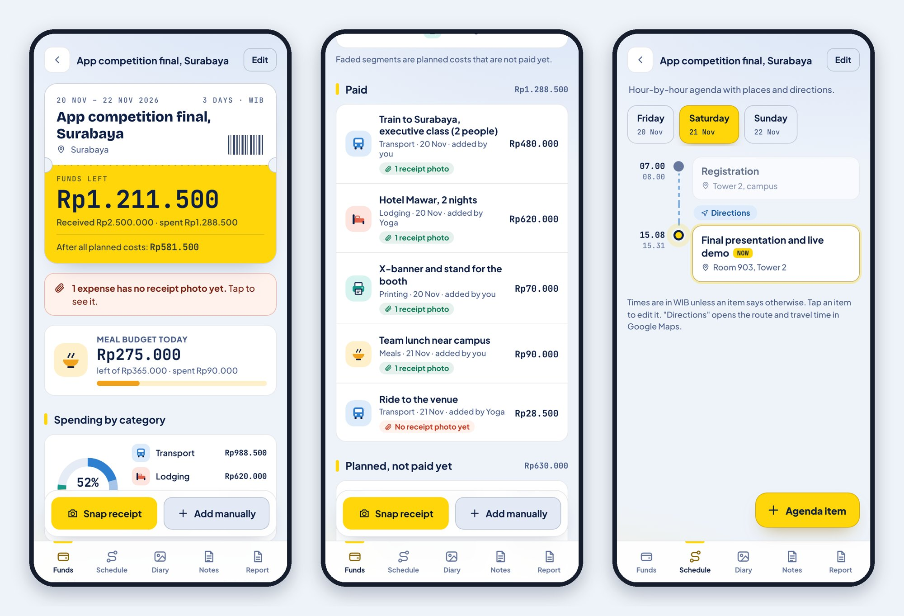
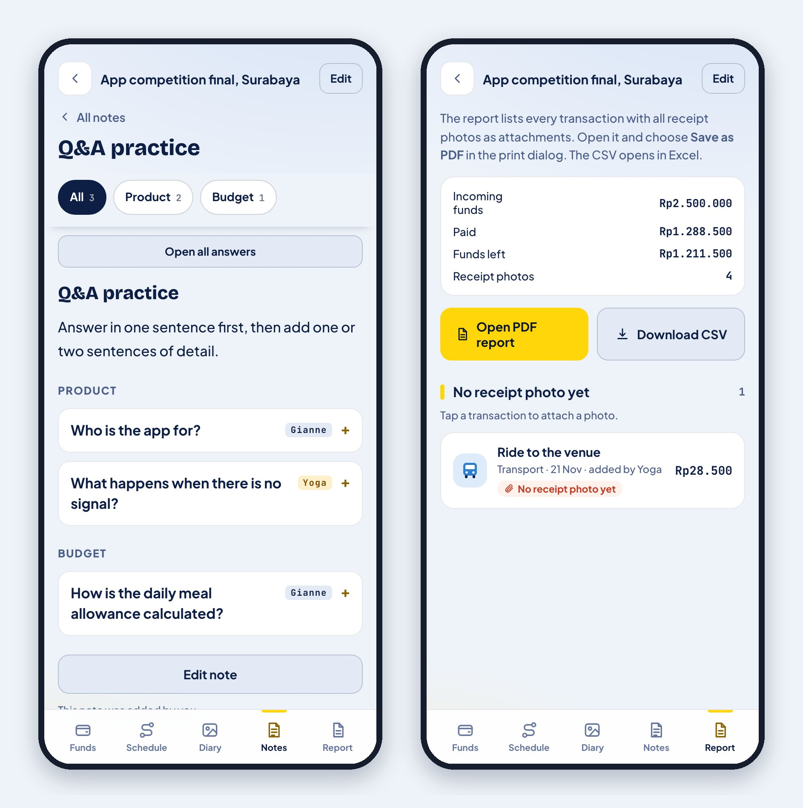
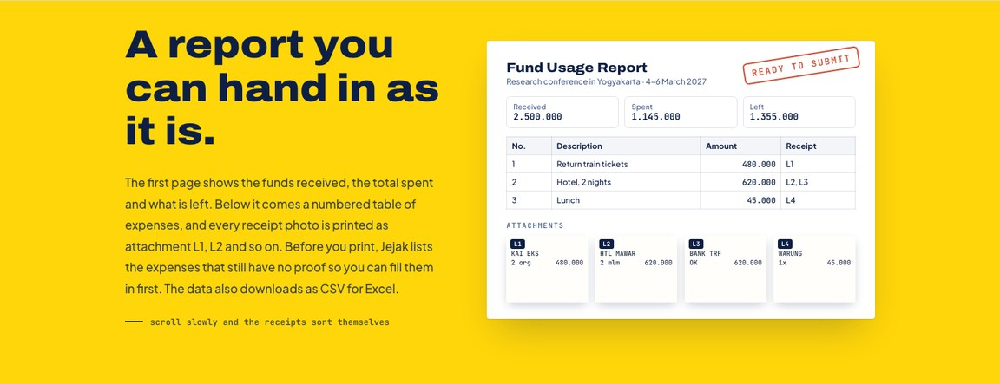

# 🧾 Jejak

**Travel funds sorted, receipts never lost.**

Jejak is a mobile-first web app for students and staff who travel on someone else's money, such as a campus grant for a competition or an office budget for a business trip, and have to account for every rupiah afterwards. You log the money that came in, snap the receipt the moment you pay, and keep the schedule in the same place. When you are back home, the accountability report with numbered receipt attachments is ready to print.

**Live:** https://jejak-trip.vercel.app &nbsp;·&nbsp; Runs in the phone's browser and installs to the home screen. No app store needed.



*The interface comes in English and Indonesian. It follows the phone's language, and the ID · EN switch on the landing page, the login screen and the Account sheet changes it at any time.*

## Why

Every competition trip ends the same way. Receipts get crumpled in a bag, travel money mixes with personal money so nobody knows what is really left, and the report gets rebuilt from memory the night before it is due, with totals that never quite match the receipts. Jejak fixes this at the moment of spending instead of at the deadline: every expense is entered with its photo while you are still standing at the counter.

## Features

| Area | What it does |
| --- | --- |
| **Funds** | Money in (campus, sponsor, personal) and money out by category (transport, lodging, meals, printing, other). Every expense is either *paid* or *planned*, so upcoming costs are already counted against the balance. |
| **Remaining balance** | The biggest number on the screen. A daily meal allowance is derived from what is left after planned costs and the days remaining in the trip. |
| **Receipts** | Take a photo or pick from the gallery. One expense can hold several photos (receipt plus transfer proof), images are compressed on the phone to save data, and expenses without proof are flagged in red. |
| **Schedule** | An editable rundown per day with times, places and a directions link. |
| **Diary** | Photos per day of the trip, with captions. |
| **Notes** | Long-form notes for the trip: scripts with speaker filters, Q&A with collapsible answers and categories, and images that only trip members can open. |
| **Report** | A printable accountability report: funds received, spent and remaining, a numbered expense table, and every receipt as a labelled attachment (L1, L2, ...). Saves as PDF through the browser's print dialog and exports to CSV for Excel. |
| **Shared trips** | Invite teammates with a join code. Members see the same trip, each entry shows who recorded it, and only the owner can delete the trip. |

## Inside the app



*Funds: the remaining balance, a reminder for the one expense without a receipt, today's meal budget, spending by category, and paid expenses with their receipt photos. Schedule: the day's agenda with directions.*



*Notes: a Q&A practice note with category filters and collapsible answers. Report: totals, PDF and CSV export, and the expenses that still need a receipt photo.*

The screenshots come from a local demo server with a fictional trip (`node scripts/demo-server.js`), so no real account or data is involved.

## On the landing page



## How it works

### Architecture

```
landing/index.html   →  /       landing page
web/                 →  /app    the app (plain JS, CSS, service worker)
api/*.js             →  Vercel Functions
  auth.js     sign up, log in, log out, current session
  trips.js    trips with fund summary, members, join codes
  items.js    entries (funds), stops (schedule), moments (diary)
  upload.js   receipt and diary photos to Vercel Blob
  img.js      note images, served only to trip members
  ai.js       optional Gemini receipt scan and budget advice
  brand.js    product name, PWA manifest, asset versioning
lib/db.js            Postgres schema and queries (Neon via @vercel/postgres)
lib/auth.js          password hashing and sessions
lib/brand.js         the one place the product name is written
```

No framework and no build step: the browser loads plain HTML, CSS and JavaScript, and Vercel serves the API as serverless functions.

### Data and access

- Every row carries a `user_id`, and every query filters by it. Trips shared through `trip_members` are readable by members only, and the API checks membership on each request.
- Passwords are hashed with scrypt and a per-user salt.
- Receipt and diary photos live in Vercel Blob. Note images are stored in the database instead, so they can only be opened through `/api/img` by a signed-in member of that trip.
- Schema changes are additive only (`CREATE TABLE IF NOT EXISTS`, `ADD COLUMN IF NOT EXISTS`), so a deploy never breaks existing data.

### Phones first

- Assets are versioned by a hash of `app.js` and `app.css`, and the HTML is never cached, so a phone that installed Jejak to its home screen always picks up the latest version without a hard refresh.
- Photos are resized and compressed on the device before upload.
- The service worker keeps notes and their images readable offline once they have been opened. API data is never cached otherwise.

### Optional AI

If `GEMINI_API_KEY` is set, Jejak can read a receipt photo and fill in the title, date, amount and category, and can suggest how to spread the remaining budget. Without the key the AI buttons disappear and everything else works the same.

## Run locally

```bash
git clone https://github.com/GianneAngely/jejak.git
cd jejak
npm install
vercel link              # a Vercel project with Neon Postgres and Blob attached
vercel env pull .env.local
vercel dev               # http://localhost:3000
```

The integrations provide `POSTGRES_URL` and `BLOB_READ_WRITE_TOKEN`. `GEMINI_API_KEY` and `AI_MODEL` are optional (see [`.env.example`](.env.example)).

Sharing and access rules are covered by an end-to-end test:

```bash
node --env-file=.env.local scripts/test-sharing.js
```

## What's inside

- **landing/**: the landing page
- **web/**: the app: `app.js`, `app.css`, `index.html`, the service worker and icons
- **api/**: the serverless API listed above
- **lib/**: database, auth and branding
- **scripts/**: deploy helper, the sharing test, and the local demo server used for the screenshots
- **docs/**: the images in this README

## Built with

Vanilla JavaScript · HTML · CSS · Service Worker · Vercel Functions · Neon Postgres · Vercel Blob · Gemini API (optional)

## Story

Jejak started as the tool for my own competition trips. It carried the MAGE 12 final at ITS Surabaya in November 2026, where our app FlowShield took 2nd place: the funds and receipts for the trip, the shared rundown with my teammate, and the presentation script and Q&A we rehearsed from on our phones. The accountability report for that trip was built from the receipts recorded here.

Made by **Gianne Angely Puspa Pilatus** ([@GianneAngely](https://github.com/GianneAngely)).
